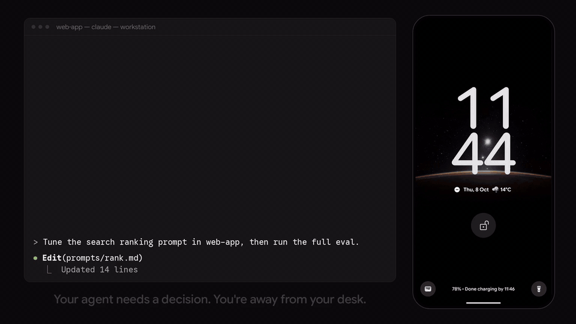

# Starbridge

Know the moment your agent is stuck.

When a coding agent stops for a question, Starbridge puts it on your phone and in your browser.
You answer with one tap, and your answer comes back as the session's next prompt. Sessions of
every harness your agents run in (Claude Code, Codex, Pi, opencode, Cursor and Antigravity), on
every machine, reach you in one place.

Starbridge also shows the runs that affect you, such as a release or an eval on a rented GPU,
answers permission prompts once you turn them on, and shows what's left on each AI plan.

Your phone, browsers and machines encrypt everything they send each other, so the server stores your
content only as ciphertext
([what the server sees](https://starbridge.run/docs/faq#what-does-the-server-see)). Use the free
server at [starbridge.run](https://starbridge.run), or host your own.



Launch week: [known issues](https://github.com/T0mSIlver/starbridge/issues?q=is%3Aissue%20label%3Aknown-issue).

## Get started

Get the app (Android, macOS, or any browser) and sign in, then install the CLI on each machine
that runs your harnesses:

```bash
curl -fsSL https://starbridge.run/install.sh | sh
```

[Start](https://starbridge.run/docs#start) has every app, the Windows, Homebrew and npm installs,
and your agent's first question.
[What each harness supports](https://starbridge.run/docs/tell-your-agents#what-each-harness-supports)
lists what works in each harness.

## Docs

[starbridge.run/docs](https://starbridge.run/docs): getting started, the CLI, agent instructions,
notifications, self-hosting and the [FAQ](https://starbridge.run/docs/faq).

CI runs the CLI's tests on Linux and macOS, and its platform tests on Windows, on every change
to the CLI. A release publishes nothing until its APK passes a smoke test on an Android emulator.

## Contributing

See [CONTRIBUTING.md](CONTRIBUTING.md). Report vulnerabilities privately: [SECURITY.md](SECURITY.md).

## Licence

[MIT](LICENSE)
