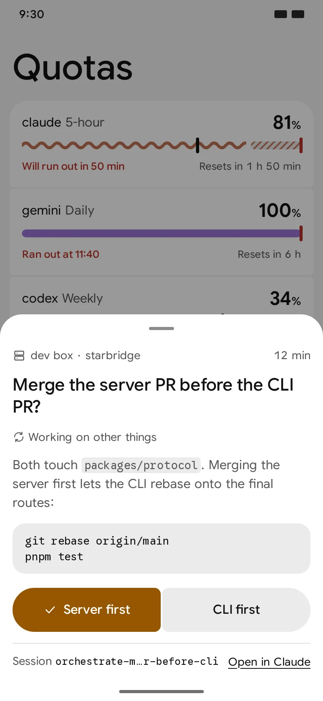

# Starbridge docs

Starbridge lets you supervise your coding agents from your phone or a browser. When an agent
needs a decision from you, you answer with one tap, and the answer goes back into the session
that asked.

Your phone, browsers and machines encrypt everything they send each other; the
[FAQ](faq.md#what-does-the-server-see) says what the server still sees. Use the free server at
starbridge.run, or [host your own](../server/README.md).

## Terms

- A **harness** is the tool an agent runs in: Claude Code, Codex, Pi, opencode, Cursor or
  Antigravity.
- An **agent** is the model working in a harness session.
- A **question picker** is a harness's own tool for asking you a question with options, such as
  Claude Code's `AskUserQuestion`.
- The **background service** is `starbridge agent`, which runs on each machine and holds its keys
  and its connection to the server.

## What you get

- **Questions.** An agent asks with two to four options, and code, images or links when they
  help you decide. Your answer comes back as the session's next prompt.
- **Runs.** A command that blocks you shows on your devices until it passes or fails
  ([Runs](#runs)).
- **Permission prompts.** Once you turn them on, your devices can allow a call once or deny it
  ([what each harness supports](tell-your-agents.md#what-each-harness-supports)).
- **Quotas.** What's left on each AI plan, read from
  [CodexBar](https://github.com/steipete/CodexBar), with optional alerts per window
  ([Notifications](notifications.md#quota-alerts)).

## Start

1. **Get the app and sign in with GitHub.**
   - Android: the APK from [GitHub Releases](https://github.com/T0mSIlver/starbridge/releases),
     or the repository in [Obtainium](https://apps.obtainium.imranr.dev/redirect?r=obtainium://add/https://github.com/T0mSIlver/starbridge)
     to get each release (and each release candidate with "Include prereleases" on).
   - Google Play, in closed testing: join [the group](https://groups.google.com/g/starbridge-testers),
     then [opt in](https://play.google.com/apps/testing/dev.starbridge.app). Testers get each
     release candidate. The APK has the Play build's signing key, so a Play install later updates
     it in place.
   - macOS: the desktop app's DMG from
     [GitHub Releases](https://github.com/T0mSIlver/starbridge/releases/latest), `arm64` for
     Apple silicon or `x64` for Intel. It updates itself; check Get Release Candidates in its
     menu bar icon's menu to get each release candidate.
   - iOS 16.4 and later: open [starbridge.run](https://starbridge.run) in Safari and add it to the
     Home Screen to get notifications. A native iPhone app is in progress.
   - Anywhere else: [starbridge.run](https://starbridge.run).

   The first device you sign in on creates your account's keys and shows your
   [recovery key](#recovery-key) once. Save it.

   To keep your keys from the server, start in the Android app and add no browser
   ([why](faq.md#what-does-the-server-see)).

2. **Install the CLI** on each machine that runs your harnesses:

   ```bash
   curl -fsSL https://starbridge.run/install.sh | sh
   ```

   On Windows, in PowerShell: `irm https://starbridge.run/install.ps1 | iex`. Homebrew and npm
   work too ([The CLI](../cli/README.md#install)). On your own server, use its address in place
   of starbridge.run.

   The script then runs `starbridge setup`.

3. **Pair the machine.** Setup prints a code, a link and a QR code. Scan the QR code with your
   phone, or open the link in a browser where you are signed in. On a machine with no browser,
   type the code on your phone in Settings → Devices → Add a device. The code expires in 10
   minutes.

   Setup then installs Starbridge in each harness it finds and starts the background service
   ([what setup does](../cli/README.md#what-setup-does)).

   CodexBar reads your AI plans' quotas. CodexBar is optional: setup asks before installing it,
   `--no-quota` skips it, and questions, runs and permission prompts work without it.

4. **Answer the test question.** Setup ends with "Send a test decision to your devices?". Say
   yes, tap Yes on your phone, browser or desktop app, and the terminal prints your answer. If
   nothing arrives, run `starbridge status`. To send one again later:

   ```bash
   starbridge ask --question "Does this reach me?" --option Yes --option No --wait
   ```

5. **Ask from an agent.** Start a new session in any harness, or
   [resume a running one](#sessions-already-running), and type:

   ```
   Ask me through Starbridge whether to name the branch "fix" or "patch", then create it.
   ```

   The question reaches your phone with the two names as buttons. Your answer comes back as the
   session's next prompt, and the agent goes on.

   

6. **Tell your agents when to reach you.** Setup gives every harness the same rules: the agent
   asks you through Starbridge for decisions that are yours, and wraps the commands that block
   you in `starbridge run`. [Agent instructions](tell-your-agents.md) covers each harness and how
   to add your own rules.

Your harnesses notify you too, so the same question can reach you twice.
[Notifications](notifications.md#turn-off-the-duplicates) says what to turn off.

## Sessions already running

A harness loads Starbridge when it starts, so a session started before setup doesn't have it.
Quit the harness and resume the session; it keeps its conversation. Run the command in the
session's own directory, since the last session is per directory.

| Harness | Resume the last session | Pick one |
|---|---|---|
| Claude Code | `claude --continue` | `claude --resume` |
| Codex | `codex resume --last` | `codex resume` |
| Pi | `pi --continue` | `pi --resume` |
| opencode | `opencode --continue` | `opencode --session <id>` |
| Cursor | `cursor-agent --continue` | `cursor-agent --resume` |
| Antigravity | `agy --continue` | `agy --conversation <id>` |

## Runs

A run is a command that blocks you or needs you at the machine, such as a release, an eval on a
rented GPU, or a test that takes over the screen. The agent wraps it in `starbridge run`:

```bash
starbridge run --title "Release 1.4" --reason "publishes to npm and Homebrew" -- make release
```

Your devices show its title, its reason, the time elapsed and its progress, then whether it
passed or failed, with the exit code. They never show the command's output. A run with no news
for 3 minutes shows as lost.

Progress comes from what the command prints: `[3/7]` steps, a percent such as `42%`, or the
terminal progress sequence OSC 9;4. The output goes through a pipe, so a progress bar that a tool
draws only on a terminal shows nothing.

To hear about other commands, such as local inference, add a line to your agents' instructions
([Lines to copy](tell-your-agents.md#lines-to-copy)). [The CLI](../cli/README.md#runs) has the
exit codes.

## Recovery key

The recovery key adds a new device to your account when you have lost every device. Keep it away
from your devices, in a password manager or on paper. The Android app can copy it or save it to
a password manager.

Replacing the key needs the current one, so a lost key is gone for good, but you keep using the
devices you have. To replace it, pick Replace next to Recovery key in Settings → Devices (in the
Android app, Settings → Devices and machines). The old key stops working.

To recover, sign in on a new phone or browser and pick "Use the recovery key". This removes every
other device and machine from the account. Add your phones and browsers again from Settings →
Devices → Add a device, and pair each machine again:

```bash
starbridge pair --force
```
